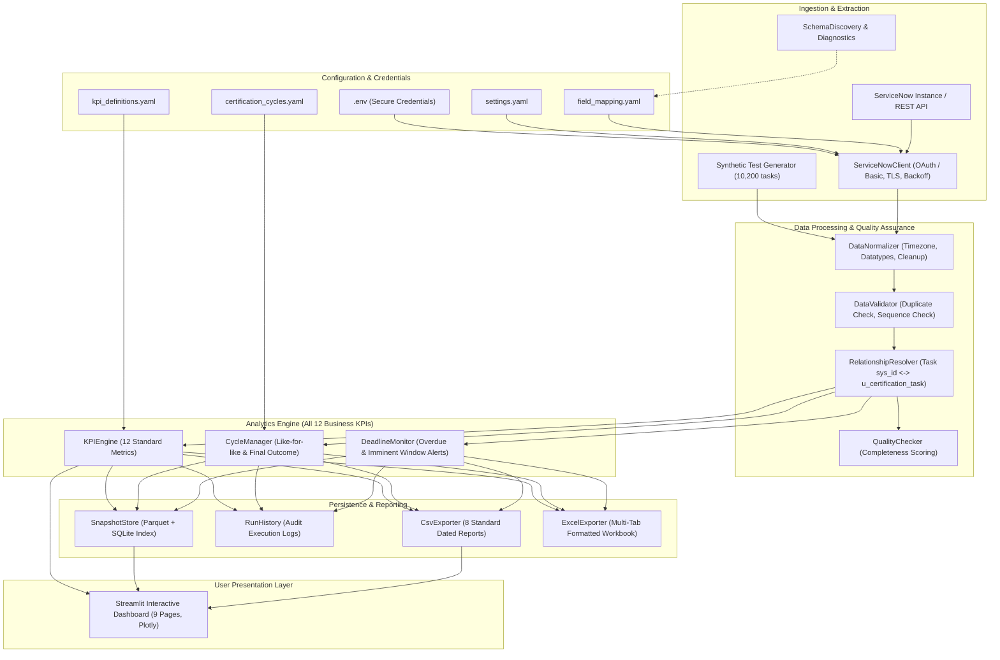

# Data Certification KPI & Performance Analysis System

An enterprise analytics, operational risk monitoring, and executive reporting system built to automate data certification performance evaluation, cycle-over-cycle comparisons, discrepancy tracking, certifier productivity analytics, and deadline compliance.

The system supports **ServiceNow Table API** extraction as well as a full **offline synthetic demonstration mode** with zero external dependencies required for initial operation.

> 📖 **Quick Overview:** For a brief, to-the-point summary of the pipeline, business cycles, and operating modes, see the **[End-to-End Project Flow Guide](docs/PROJECT_FLOW.md)**.

---

## 1. System Architecture

The pipeline follows a deterministic, auditable data engineering architecture:



---

## 2. All 12 Business KPIs Summary

| # | Business KPI Name | Formula | Denominator Definition | Desired Trend |
|---|---|---|---|:---:|
| **1** | **Certification Completion %** | `Successfully Certified Tasks / Total Eligible Assigned Tasks × 100` | Eligible assigned tasks (excluding cancelled) | Higher |
| **2** | **Daily Closure Rate** | `Tasks Completed During Period / Working Days Elapsed` | Working days elapsed in cycle (calendar-aware) | Higher |
| **3** | **On-Time Completion %** | `Tasks Completed On or Before Due Date / Completed Tasks With Valid Due Dates × 100` | Completed tasks with valid non-null due dates | Higher |
| **4** | **Average Completion Time** | `Average(Valid Completion Timestamp − Creation Timestamp)` | Completed tasks with valid timestamps (days) | Lower |
| **5** | **Discrepancy Rate** | `Certified Records With ≥1 Valid Discrepancy / Records in Scope × 100` | Distinct records certified in scope | Lower |
| **6** | **Data Accuracy / Pass Rate** | `Records Passing Validation Without Discrepancy / Records Evaluated × 100` | Distinct certified records evaluated | Higher |
| **7** | **Rejection / Rework Rate** | `Tasks Returned for Rework / Tasks Submitted for Review × 100` | Tasks submitted for review | Lower |
| **8** | **Aging / Backlog** | `Task Age = As-of Timestamp − Task Creation Timestamp` | Open tasks backlog (buckets: 0-4, 5-9, 10-14, 15+ days) | Lower |
| **9** | **Productivity per Certifier** | `Tasks Completed by Certifier / Applicable Working Days` | Active certifiers × applicable working days | Higher |
| **10** | **Last-Minute Closure %** | `Completed Within Final N Days Before Due / Completed With Due Dates × 100` | Completed tasks with valid due dates (N=5 days) | Lower |
| **11** | **Exception Resolution Time**| `Resolution Timestamp − Exception Creation Timestamp` | Resolved discrepancies with valid timestamps | Lower |
| **12** | **Final SLA Achievement %** | `Completed On or Before Final Deadline / Total Cycle Workload × 100` | Total eligible tasks assigned to cycle (incl. incomplete) | Higher |

---

## 3. Quick Start (Windows Command Prompt)

### 3.1 Setup Virtual Environment and Dependencies
```bat
python -m venv .venv
.venv\Scripts\activate.bat
python -m pip install --upgrade pip
pip install -r requirements.txt
```

### 3.2 Run in Offline Demo Mode (No API Credentials Required)
```bat
REM Validate local configuration
python main.py validate-config

REM Generate synthetic demo dataset (10,200 tasks, 1,060 discrepancies)
python main.py generate-demo

REM Execute end-to-end analytical pipeline
python main.py pipeline --mode demo

REM Run certification cycle comparison
python main.py compare-cycles

REM Check deadline risks and overdue alerts
python main.py deadline-check

REM Run pytest test suite
.venv\Scripts\pytest -v

REM Launch interactive Streamlit dashboard
streamlit run src/dashboard/app.py
```
The dashboard will open automatically in your browser at `http://localhost:8501`.

---

## 4. Live ServiceNow API Configuration

To connect the application to an active ServiceNow instance:

1. Copy `.env.example` to `.env`:
   ```bat
   copy .env.example .env
   ```
2. Open `.env` in a text editor and enter your instance details:
   ```dotenv
   API_BASE_URL=https://your-instance.service-now.com
   API_PROVIDER=servicenow
   API_AUTH_METHOD=basic
   API_USERNAME=your_read_only_service_account
   API_PASSWORD=your_password
   API_TIMEOUT_SECONDS=30
   API_PAGE_SIZE=500
   API_MAX_RETRIES=3
   API_VERIFY_TLS=true
   APP_MODE=live
   ```
3. Test connectivity and discover source fields:
   ```bat
   python main.py test-connection
   python main.py discover-schema
   ```
4. Run the live pipeline:
   ```bat
   python main.py pipeline --mode live
   ```
5. Launch the dashboard to view live results:
   ```bat
   streamlit run src/dashboard/app.py
   ```

---

## 5. CLI Command Reference

| Command | Purpose |
|---|---|
| `python main.py validate-config` | Verifies YAML syntax, non-overlapping dates, and field mappings |
| `python main.py test-connection` | Validates API connectivity, authentication, and table access |
| `python main.py discover-schema` | Inspects remote dictionary and samples table fields |
| `python main.py generate-demo` | Generates 10,200 synthetic tasks across Q3 and Q4 cycles |
| `python main.py pipeline --mode demo` | Runs full processing, KPI calculation, and exports in demo mode |
| `python main.py pipeline --mode live` | Runs extraction against live ServiceNow API and produces reports |
| `python main.py compare-cycles` | Computes percentage point and percentage differences between cycles |
| `python main.py export` | Refreshes and outputs all CSV and Excel reports |
| `python main.py deadline-check` | Identifies tasks overdue or due within 5 days |
| `python -m pytest -v` | Executes test suite |
| `streamlit run src/dashboard/app.py` | Launches interactive browser dashboard |

---

## 6. Generated Reports & Export Locations

After running the pipeline, reports are saved to `reports/`:
- **`Data_Certification_KPI_Report_latest.xlsx`**: Consolidated multi-sheet Excel workbook with Management Summary, All KPIs, Cycle Comparison, Daily Trends, Backlog Analysis, Discrepancies, Certifier Productivity, Exception Resolution, and Data Quality.
- **`kpi_summary.csv`**: All 12 KPIs with formulas, numerators, denominators, and status.
- **`cycle_comparison.csv`**: Like-for-like and final outcome comparison between Q3 and Q4.
- **`daily_trends.csv`**: Day-by-day closures, cumulative count, and 7-day moving average.
- **`backlog_analysis.csv`**: Open task list, age in days, aging bucket, and overdue flag.
- **`discrepancy_analysis.csv`**: Failure categories, resolved counts, and resolution rates.
- **`certifier_productivity.csv`**: Assigned workload, closures, completion rate, daily rate.
- **`exception_resolution.csv`**: Turnaround duration in days per discrepancy.
- **`data_quality_report.csv`**: Audit completeness scores and validation outcomes.

Historical snapshots are archived in `data/snapshots/` as `.parquet` files indexed in `snapshot_index.sqlite`.

---

## 7. Windows Task Scheduler Setup (Deadline Alerts)

To automate the daily deadline check at 08:00 AM every working day:

1. Open **Task Scheduler** in Windows (`taskschd.msc`).
2. Click **Create Basic Task**.
3. Set Name to `DataCert_Deadline_Monitor`.
4. Trigger: **Daily** at `08:00 AM`.
5. Action: **Start a program**.
6. Program/script: `C:\Users\Ansh Singh\OneDrive\Desktop\DATA CERTIFICATION KPI and PERFORMANCE ANALYTICS\.venv\Scripts\python.exe`
7. Arguments: `main.py deadline-check`
8. Start in: `C:\Users\Ansh Singh\OneDrive\Desktop\DATA CERTIFICATION KPI and PERFORMANCE ANALYTICS`
9. Click **Finish**.

---

## 8. Security Safeguards

- **No Hardcoded Secrets**: Secrets reside only in `.env`, which is ignored by version control.
- **Strict Read-Only Integration**: The connector only executes HTTP GET operations; no modifications or deletions are performed on source records.
- **TLS Verification**: Enabled by default (`API_VERIFY_TLS=true`).
- **No External Cloud AI / LLM Calls**: All KPI calculations are deterministic, offline, and locally executed.
