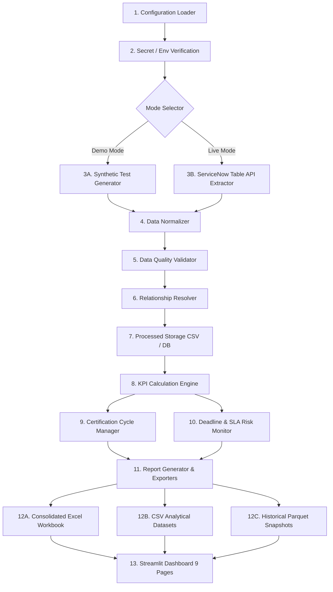

# Architecture Specification — Data Certification KPI & Performance Analysis

## 1. System Overview

The **Data Certification KPI & Performance Analysis System** is an enterprise data engineering and analytics solution. It automates the collection, normalization, relationship linking, metric evaluation, cycle comparison, and executive presentation of data certification processes.

## 2. Design Principles

1. **Deterministic Offline Analytics**: Core KPI calculations are deterministic and rely strictly on validated formulas and business day calendars. No generative AI or cloud LLMs are utilized for metrics.
2. **Provider Decoupling**: ServiceNow Table API logic is encapsulated in `ServiceNowClient` extending `ApiClient` and `BaseClient`. Switching providers (e.g. Jira, Remedy, Custom REST) requires only replacing the connector without altering the analytics engine.
3. **Data Quality Integrity**: Invalid, duplicate, or impossible date sequence records are quarantined into separate sets rather than silently dropped or masked.
4. **Relationship Verification**: Discrepancies (`u_failed_data_certifications`) are strictly linked to tasks (`cert_task`) using verified record keys (`u_certification_task` <-> `sys_id`). The system explicitly avoids pseudo-joins based on application names alone.

## 3. End-to-End Pipeline Stages

### Stage Details:
- **Configuration Layer (`src/config`)**:
  - `loader.py`: Reads YAML configs (`settings.yaml`, `field_mapping.yaml`, `kpi_definitions.yaml`, `certification_cycles.yaml`) and `.env`.
  - `validation.py`: Verifies non-overlapping cycles, date formats, threshold logic, and required keys.
- **Connectors Layer (`src/connectors`)**:
  - `base_client.py`: Requests session with connection pooling, exponential backoff, rate limit handling (HTTP 429), and strict TLS validation.
  - `service_now_client.py`: Specialized for ServiceNow Table API (`/api/now/table/{table}`) and Dictionary API (`/api/now/table/sys_dictionary`).
- **Data Processing Layer (`src/data_processing`)**:
  - `normalizer.py`: Standardizes column naming, parses ISO timestamps, converts timezones, and strips whitespace.
  - `validator.py`: Flags duplicates, impossible sequences (closed < created), and missing keys.
  - `relationships.py`: Links discrepancies to tasks, reports orphaned rows, and aggregates issue counts.
- **Analytics Layer (`src/analytics`)**:
  - `kpi_engine.py`: Encapsulates all 12 business KPIs, producing audit numerators, denominators, and warnings.
  - `cycle_manager.py`: Calculates calendar and working days elapsed, performs like-for-like and final cycle comparisons.
- **Reporting & Storage (`src/reporting`, `src/storage`)**:
  - `report_generator.py`: Assembles structured DataFrames for reporting.
  - `excel_exporter.py`: Generates styled Excel workbooks with custom formatting and auto-column widths.
  - `snapshot_store.py`: Saves compressed Parquet archives indexed via SQLite.
- **Dashboard Layer (`src/dashboard`)**:
  - `app.py`: Streamlit-based interface with Plotly visualizations, responsive layouts, and KPI cards.
